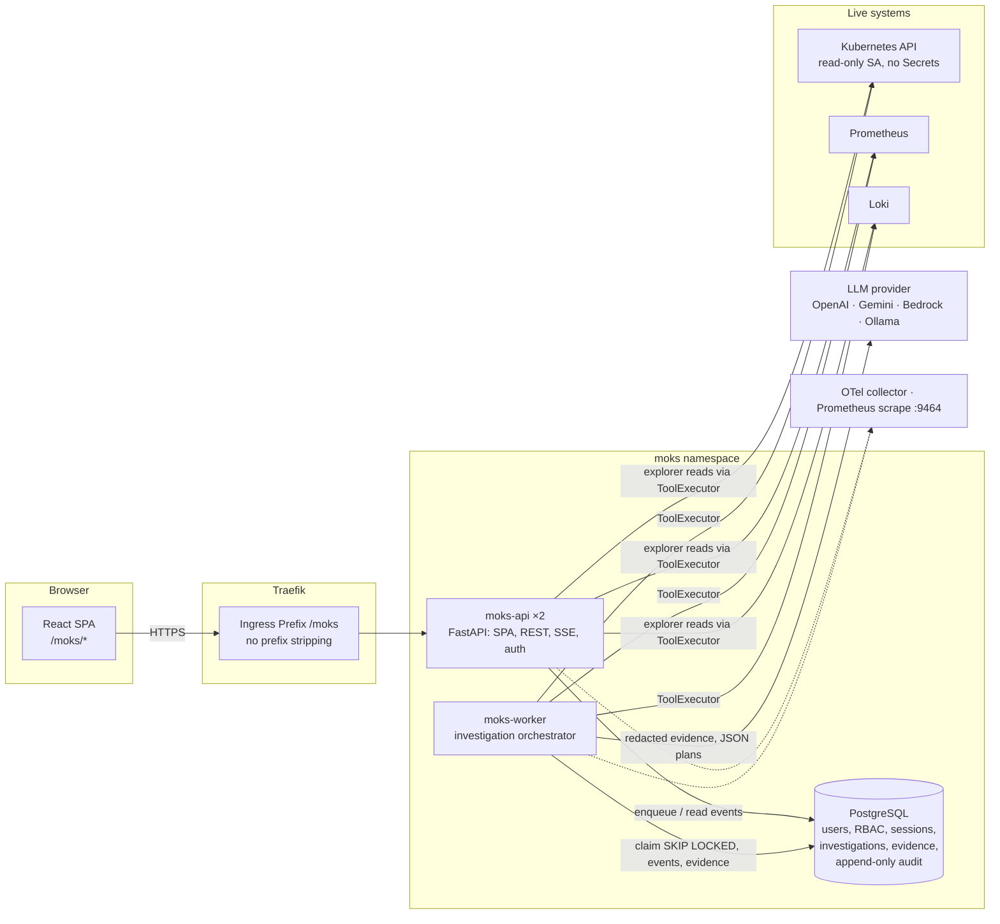
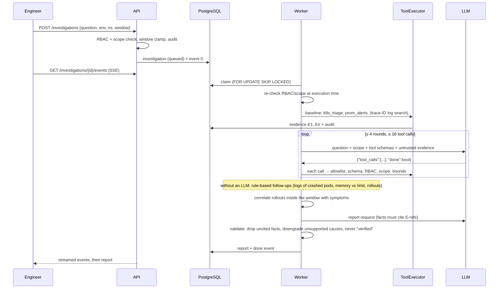
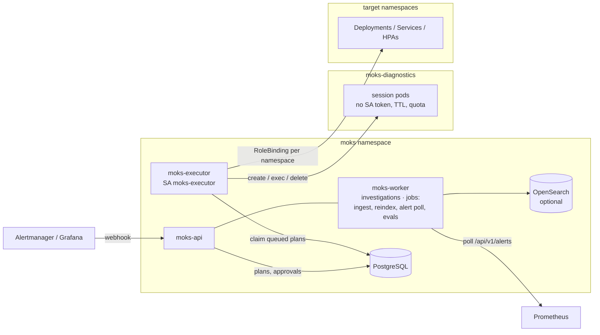

# MOKS architecture

MOKS is an SRE investigation portal for Production Operations. An engineer asks a question. MOKS
collects live evidence through typed, policy-checked, read-only tools, correlates it, and returns
a report that keeps facts, suspected causes, missing evidence, next steps and proposed remediation
separate. Every fact cites the evidence it came from.

Status: **Phases 1–4 are implemented, plus FinOps and SRE skills.** Phase 1 runs on mk4; the
later phases are tested locally and live (read-only) against mk4 but not yet deployed there.
See [LIMITATIONS.md](LIMITATIONS.md).

## Components



| Responsibility (requirement) | Phase 1 implementation |
|---|---|
| 1. Web portal and authenticated API | `moks-api` (FastAPI) serves the React build, the JSON API, SSE and OIDC callbacks under `/moks` |
| 2. Investigation orchestrator | `moks-worker` runs `moks.orchestrator.engine.Investigator`, one asyncio task per investigation |
| 3. Typed connectors and tool registry | `moks.connectors.*` (Kubernetes, Prometheus, Loki) and `moks.tools` (17 typed tools, one executor) |
| 4. RAG ingestion/retrieval workers | `moks.rag`: GitHub/upload/postmortem ingestion as background jobs in the worker; Postgres full-text, pgvector or OpenSearch (BM25 + k-NN, RRF) |
| 5. Approval and remediation service | `moks.actions.service`: allowlisted, hash-bound action plans with approvals, expiry and replay protection |
| 6. Isolated execution workers | `moks-executor`: the only write-capable process, with its own ServiceAccount bound per namespace; runs actions and diagnostic-session pods in an isolated namespace |
| 7. Audit and observability | Hash-chained `audit_events` (DB triggers), Prometheus metrics, JSON logs, OTel traces, Grafana dashboard |

The LLM never holds credentials. It receives redacted evidence and returns *requests*. The
executor validates each request against the tool allowlist, the argument schema, application
RBAC and environment scope before any connector runs.

## Path handling at `/moks`

The existing Traefik setup serves `jithendar.com/` (Next.js), `/grafana`, `/prometheus`,
`/argocd` and `/roboshop` from one host with a shared default TLSStore. Grafana serves its own
sub-path, while RoboShop uses a `stripPrefix` middleware. MOKS follows the Grafana pattern:

- The Ingress is a `Prefix /moks` rule with **no middleware**. Traefik ranks the longer rule above
  the site's `/`. There is no compression middleware either, because it could buffer SSE.
- The app owns its base path (`MOKS_BASE_PATH=/moks`): API at `/moks/api`, docs at
  `/moks/api/docs` (when `MOKS_API_DOCS=true`), OIDC callback at `/moks/api/auth/oidc/callback`.
- Vite builds with `base: /moks/`, and React Router uses `basename="/moks"`. FastAPI answers
  every non-API, non-asset path under `/moks/` with `index.html` (`Cache-Control: no-cache`), so
  deep links survive refresh. A missing `/moks/assets/*` returns 404 rather than HTML.
- The session cookie uses `Path=/moks`, and logout redirects to `/moks/login` (or the IdP's
  `end_session_endpoint` with `post_logout_redirect_uri=https://jithendar.com/moks/login`).

`jithendar.com/roboshop/moks/*` is the unrelated RoboShop shopping widget (also called "Moks").
It is untouched. The new Argo CD Application is `moks-portal` because `moks` is taken.

## Investigation loop



Limits are enforced in code: `MOKS_MAX_TOOL_CALLS` (16), `MOKS_MAX_LLM_ROUNDS` (4),
`MOKS_MAX_DURATION_SECONDS` (180, via `asyncio.timeout`), query window
(`min(environment.max_query_window_minutes, MOKS_MAX_QUERY_WINDOW_MINUTES)`), per-result size
(`MOKS_MAX_RESULT_BYTES`, structured truncation), connector page and line caps, tokens per
investigation (`MOKS_MAX_TOKENS_PER_INVESTIGATION`) and the LLM configuration's daily USD budget.
Cancellation is immediate: a watcher task polls `cancel_requested` every second and cancels the
run, which then stores a partial rule-based report of the evidence collected so far.

An unavailable connector becomes a note and a "missing evidence" item, not a failure. If the
LLM fails or exceeds budget, MOKS falls back to rule-based follow-ups and report and says so.

### Report contract

`moks.orchestrator.report.Report`: `summary`, `observed_facts[{statement, evidence[]}]`,
`suspected_causes[{cause, confidence low|medium|high, evidence[], reasoning, verified=false}]`,
`missing_evidence[]`, `next_steps[]`,
`proposed_remediation[{action, target, expected_impact, risk, rollback, requires_approval=true, executable=false}]`.
The report also stores the scope, the window, the rule-based findings and the validation counts.

## Security boundaries

- **Two independent authorization layers.** Application RBAC (role bindings scoped by environment
  and namespace patterns) is intersected with infrastructure scope (environment allow/deny
  namespace lists, plus the connector credential's own Kubernetes RBAC and IAM). Both are checked
  in the API and again in the executor at execution time. See [SECURITY.md](SECURITY.md).
- **Untrusted data.** Logs, events, documents and tool output are wrapped in randomly tagged
  `<untrusted_data>` blocks. Instructions inside them cannot add tools or widen scope, because
  those decisions are made by code, not by the model.
- **No shell, no write tools.** Every Phase 1 tool is `read_only=True`. The executor rejects
  privileged or mutating tools outright, and the in-cluster ClusterRole has no write verbs,
  Secrets, `pods/exec`, `pods/attach` or `pods/portforward`.

## Data model

Migration `backend/moks/migrations/versions/0001_initial.py`:

| Table | Purpose |
|---|---|
| `users` | OIDC (`subject`), local (argon2id `password_hash`) or dev users |
| `role_bindings` | `role × environment pattern × namespace pattern`, with `source` (manual, cli, bootstrap, oidc-group) |
| `sessions` | SHA-256 of the cookie token, CSRF token, idle/absolute expiry, revocation |
| `environments` | Cluster definitions and infrastructure scope (allowed/denied namespaces, max window, Grafana link) |
| `connectors` | Type, non-secret JSON config and a **credential reference** (`env:MOKS_CRED_*` or a file under the credentials mount) |
| `llm_configs` | Provider, model, endpoint/region, credential reference, timeout, budget, prices; one active per purpose (`chat`, `embedding`) |
| `llm_usage` | Tokens and estimated cost per call (daily budget enforcement) |
| `investigations` | Question, scope, window, status, report, counters, worker heartbeat |
| `investigation_events` | Ordered progress stream (SSE source, replayable) |
| `evidence` | Citable results (`E1`…): tool, args, scope, summary, redacted/truncated data, exact query/API source, timing |
| `audit_events` | Append-only, hash-chained (`chain_seq`, `prev_hash`, `hash`); UPDATE/DELETE/TRUNCATE rejected by triggers |

## Phases 2–4 as built



- **Connectors (Phase 2):** Grafana (dashboards, panel queries, unified alerting); CloudWatch (Logs
  Insights start/poll/stop with log-group, region, account and window allowlists, plus metrics and
  alarms); Git with a GitHub provider (files, commits, compare, and deployment-to-commit resolution
  that **never guesses**); EKS from outside the cluster (native presigned-STS tokens); FinOps
  (Cost Explorer, anomalies, budgets, a Kubernetes cost model). See [CONNECTORS.md](CONNECTORS.md)
  and [FINOPS.md](FINOPS.md).
- **RAG (Phase 2):** PostgreSQL holds documents and chunks. Chunking follows Markdown headings,
  YAML documents and code blank-line windows, with line ranges for citations. Sync is incremental
  (git blob SHA), deletions propagate, secret files are excluded with a recorded reason, and
  content is redacted. Retrieval is filtered twice (SQL pre-filter, authoritative post-filter).
  Embedding indexes are versioned (`moks-chunks-<id>`), and a model change builds a new index
  before switching. *Assumption retained:* "OpenGraph vector database" is read as OpenSearch; there
  is no graph database.
- **Incidents (Phase 2):** a workspace with a timeline, hypotheses, linked investigations, action
  plans and their validation, plus a Markdown report. Approved postmortems are indexed into the
  knowledge base, scoped to the incident's environment and namespace.
- **Actions (Phase 3):** plans carry exact targets, the API operation, reason and evidence, impact
  and blast radius, preconditions, validation, rollback and expiry. They are bound by SHA-256 to
  environment, namespace, action, target, parameters, requester, expiry and the target's
  `resourceVersion`. There is no self-approval, and approvals are re-checked at execution.
  Execution is at most once, with optimistic concurrency, rollout validation, and automatic
  restore of the captured pre-state on failure.
- **Diagnostic sessions (Phase 3):** an image catalog (netshoot, curl, python), pinned package
  catalog and argv-only command templates with validated arguments and an SSRF guard. Sessions
  have a TTL, are deleted on expiry, and require approval in production or when elevated.
- **Alerts (Phase 4):** Alertmanager/Grafana webhook (bearer token) and a Prometheus poller.
  Alerts are fingerprinted, deduplicated against open incidents, subject to a cooldown and an
  hourly cap, and investigated automatically by the automation principal only where
  `auto_investigate` is on.
- **Evaluation (Phase 4):** datasets replay recorded cluster state through the real orchestrator
  and score expected findings, required facts, forbidden claims, citation validity and false
  positives.
- **SRE skills:** `SKILL.md` playbooks select themselves from questions and findings, run
  read-only steps and suggest allowlisted actions. See [SKILLS.md](SKILLS.md).

Additional tables (migration `0002`): `incidents`, `incident_events`, `jobs`, `knowledge_sources`,
`documents`, `chunks` (generated `tsvector`), `embedding_indexes`, `chunk_embeddings` (vector
column when pgvector exists), `action_plans`, `approvals`, `diagnostic_sessions`,
`diagnostic_commands`, `alert_events`, `eval_runs`, plus environment policy columns
(`auto_investigate`, cooldown, `max_replicas`, `allow_scale_to_zero`, `plan_ttl_minutes`) and the
`automation@moks.system` principal.

## Safe execution

A plan binds to the connector, its write target and the cluster (`kube-system` UID), and to the
object's UID. There is no default write target: a Kubernetes connector without `config.executor` is
read-only, so a plan cannot land on the cluster hosting MOKS by accident.

Immediately before acting, the executor re-checks the allowlist and parameters, current policy,
approval requirements, the requester's and executor's permissions, the approver's permission, and
the target's identity. It commits an `intent` checkpoint, mutates once, reads the result back and
commits `applied`. A heartbeat renews a 90-second lease.

```
pending -> approved -> queued -> executing -> succeeded
                                     |-> failed                     (definitely not applied, or validation failed)
                                     |-> recovered                  (restored, and the restore validated)
                                     '-> reconciliation_required -> reconciled   (a person records the outcome)
```

An uncertain outcome is never retried. Recovery restores only the fields MOKS changed, and only if
they still hold what MOKS applied.

## Metrics

A source is one connector seen with one level of access. Environments are served by one query only
when the connector's full identity (endpoint, tenant, settings, credential) and the caller's effective
scope match; a shared URL alone proves nothing. Every enabled connector is queried unless the caller
picks some, and results name the connector. Catalogs are cached per source, so a scoped user is never
served a wider user's list. Users without environment-wide access discover metrics only through series
in their own namespaces. Sources are evaluated separately and never added together. Raw PromQL needs `metrics.raw_query` for all namespaces, because it cannot be confined to
one. Explore builds the query itself and pins the namespace, so it works for scoped users. CloudWatch
has its own query path and is labelled as such.

## Detection

Rules live in `SKILL.md` and are deterministic; an LLM plays no part. Each check ends as `firing`,
`ok` or `unknown`. `unknown` changes nothing, so a telemetry outage neither opens nor resolves an
incident. A check also records what it read in full. Recovery is inferred only for resources in that
coverage: a failed or truncated namespace, one outside this run's slice, or a capped result proves
nothing. Namespaces rotate across runs, so every namespace is reached in environments with more than 40.

Incident identity is `sha256(rule, environment, namespace, kind, resource)`, enforced by a partial
unique index across workers. Pods resolve to their owning workload, so restarts update one incident.
Rule schemas have no action field: an incident never authorizes a change.

## Background jobs

Jobs hold a renewable lease, and the worker reclaims any job whose lease lapses, so a killed worker
cannot block a dedupe key. What happens next depends on the operation:

| Job | Attempts | After a crash |
|---|---|---|
| `knowledge_sync` | 3 | Retried; it resumes from what it committed |
| `knowledge_reindex` | 2 | Build marked failed, then retried beside the active index |
| `alert_poll`, `detection_tick` | 1 | Dropped; the scheduler queues the next one |
| `eval_run` | 1 | Marked failed; a person starts it again |

A worker that loses its lease cancels its own run and cannot overwrite the new owner's result.

## Investigations

Causes have two tiers. **Verified** causes come only from detectors that observe the fault directly
(`service_selector_mismatch`, `oomkilled`, `image_pull`, `unschedulable`, `config_ref_missing`).
Everything from an LLM stays **suspected**, whatever its confidence.

## Conversations

A conversation groups investigations as turns. Each turn is a normal investigation owned by the person who
asked, so RBAC, scope and audit apply per turn. Earlier messages reach the model only as untrusted context.
Each turn reads logs in every mode, before skills and before any LLM planning: previous logs for containers
that restarted, current logs, and Loki when previous logs are gone. The last failure a crashed container wrote
becomes a `crash_log_reason` finding, quoted verbatim.

## Vector backends

OpenSearch and Pinecone offer the same index lifecycle: versioned indexes, a build beside the active one, and
cleanup after the switch commits. Pinecone holds vectors only, so its keyword half is PostgreSQL full-text
search. Either way the index is derived data and PostgreSQL stays the system of record.

## Durability

PostgreSQL is the only system of record. Everything else is rebuildable or a short-lived cache. On mk4 it
runs on one volume on one disk, so the off-cluster backup is the only copy that survives losing that
disk. Backups are encrypted before they leave the cluster, are read back before retention runs, and report
through `backup_runs`, so an alert fires on the age of the last success: a job that never starts is caught
as well as one that fails. There is no point-in-time recovery; see [LIMITATIONS.md](LIMITATIONS.md).

