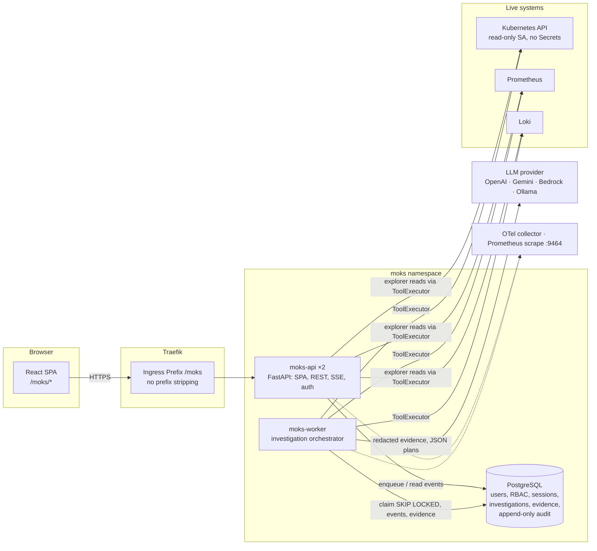
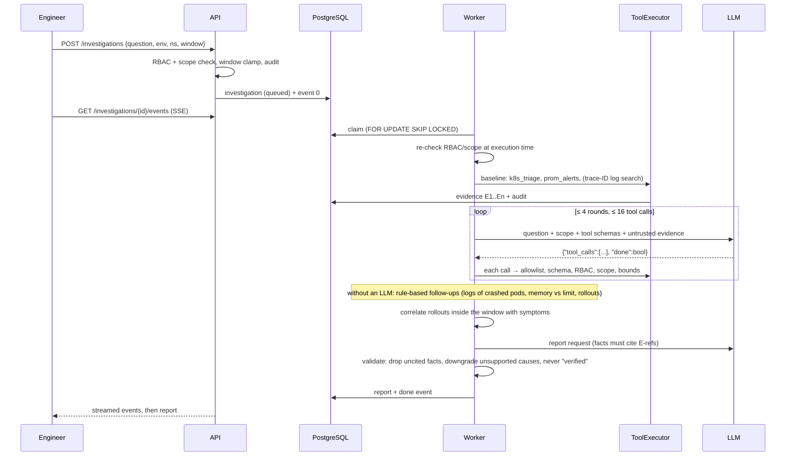

# MOKS architecture

MOKS is an SRE investigation portal for Production Operations. An engineer asks a question. MOKS
collects live evidence through typed, policy-checked, read-only tools, correlates it, and returns
a report that keeps facts, suspected causes, missing evidence, next steps and proposed remediation
separate. Every fact cites the evidence it came from.

Status: **Phase 1 (read-only vertical slice) is implemented.** Phases 2–4 are designed below but
not built. See [LIMITATIONS.md](LIMITATIONS.md).

## Components

| Responsibility (requirement) | Phase 1 implementation |
|---|---|
| 1. Web portal and authenticated API | `moks-api` (FastAPI) serves the React build, the JSON API, SSE and OIDC callbacks under `/moks` |
| 2. Investigation orchestrator | `moks-worker` runs `moks.orchestrator.engine.Investigator`, one asyncio task per investigation |
| 3. Typed connectors and tool registry | `moks.connectors.*` (Kubernetes, Prometheus, Loki) and `moks.tools` (17 typed tools, one executor) |
| 4. RAG ingestion/retrieval workers | Phase 2 (OpenSearch; pgvector profile). Chart has the switch, defaulting to `none` |
| 5. Approval and remediation service | Phase 3. Phase 1 *proposes* remediation only; nothing is executable |
| 6. Isolated execution workers | Phase 3 (separate ServiceAccount and Job pods per action/diagnostic session) |
| 7. Audit and observability | Hash-chained `audit_events` (DB triggers), Prometheus metrics, JSON logs, OTel traces, Grafana dashboard |

The LLM never holds credentials. It receives redacted evidence and returns *requests*. The
executor validates each request against the tool allowlist, the argument schema, application
RBAC and environment scope before any connector runs.

## Path handling at `/moks`

The existing Traefik setup serves `jithendar.com/` (Next.js), `/grafana`, `/prometheus`,
`/argocd` and `/roboshop` from one host with a shared default TLSStore. Grafana serves its own
sub-path, while RoboShop uses a `stripPrefix` middleware. MOKS follows the Grafana pattern:

- The Ingress is a `Prefix /moks` rule with **no middleware**. Traefik ranks the longer rule above
  the site's `/`. There is no compression middleware either, because it could buffer SSE.
- The app owns its base path (`MOKS_BASE_PATH=/moks`): API at `/moks/api`, docs at
  `/moks/api/docs` (when `MOKS_API_DOCS=true`), OIDC callback at `/moks/api/auth/oidc/callback`.
- Vite builds with `base: /moks/`, and React Router uses `basename="/moks"`. FastAPI answers
  every non-API, non-asset path under `/moks/` with `index.html` (`Cache-Control: no-cache`), so
  deep links survive refresh. A missing `/moks/assets/*` returns 404 rather than HTML.
- The session cookie uses `Path=/moks`, and logout redirects to `/moks/login` (or the IdP's
  `end_session_endpoint` with `post_logout_redirect_uri=https://jithendar.com/moks/login`).

`jithendar.com/roboshop/moks/*` is the unrelated RoboShop shopping widget (also called "Moks").
It is untouched. The new Argo CD Application is `moks-portal` because `moks` is taken.

## Investigation loop

Limits are enforced in code: `MOKS_MAX_TOOL_CALLS` (16), `MOKS_MAX_LLM_ROUNDS` (4),
`MOKS_MAX_DURATION_SECONDS` (180, via `asyncio.timeout`), query window
(`min(environment.max_query_window_minutes, MOKS_MAX_QUERY_WINDOW_MINUTES)`), per-result size
(`MOKS_MAX_RESULT_BYTES`, structured truncation), connector page and line caps, tokens per
investigation (`MOKS_MAX_TOKENS_PER_INVESTIGATION`) and the LLM configuration's daily USD budget.
Cancellation is immediate: a watcher task polls `cancel_requested` every second and cancels the
run, which then stores a partial rule-based report of the evidence collected so far.

An unavailable connector becomes a note and a "missing evidence" item, not a failure. If the
LLM fails or exceeds budget, MOKS falls back to rule-based follow-ups and report and says so.

### Report contract

`moks.orchestrator.report.Report`: `summary`, `observed_facts[{statement, evidence[]}]`,
`suspected_causes[{cause, confidence low|medium|high, evidence[], reasoning, verified=false}]`,
`missing_evidence[]`, `next_steps[]`,
`proposed_remediation[{action, target, expected_impact, risk, rollback, requires_approval=true, executable=false}]`.
The report also stores the scope, the window, the rule-based findings and the validation counts.

## Security boundaries

- **Two independent authorization layers.** Application RBAC (role bindings scoped by environment
  and namespace patterns) is intersected with infrastructure scope (environment allow/deny
  namespace lists, plus the connector credential's own Kubernetes RBAC and IAM). Both are checked
  in the API and again in the executor at execution time. See [SECURITY.md](SECURITY.md).
- **Untrusted data.** Logs, events, documents and tool output are wrapped in randomly tagged
  `<untrusted_data>` blocks. Instructions inside them cannot add tools or widen scope, because
  those decisions are made by code, not by the model.
- **No shell, no write tools.** Every Phase 1 tool is `read_only=True`. The executor rejects
  privileged or mutating tools outright, and the in-cluster ClusterRole has no write verbs,
  Secrets, `pods/exec`, `pods/attach` or `pods/portforward`.

## Data model

Migration `backend/moks/migrations/versions/0001_initial.py`:

| Table | Purpose |
|---|---|
| `users` | OIDC (`subject`), local (argon2id `password_hash`) or dev users |
| `role_bindings` | `role × environment pattern × namespace pattern`, with `source` (manual, cli, bootstrap, oidc-group) |
| `sessions` | SHA-256 of the cookie token, CSRF token, idle/absolute expiry, revocation |
| `environments` | Cluster definitions and infrastructure scope (allowed/denied namespaces, max window, Grafana link) |
| `connectors` | Type, non-secret JSON config and a **credential reference** (`env:MOKS_CRED_*` or a file under the credentials mount) |
| `llm_configs` | Provider, model, endpoint/region, credential reference, timeout, budget, prices; one active per purpose (`chat`, `embedding`) |
| `llm_usage` | Tokens and estimated cost per call (daily budget enforcement) |
| `investigations` | Question, scope, window, status, report, counters, worker heartbeat |
| `investigation_events` | Ordered progress stream (SSE source, replayable) |
| `evidence` | Citable results (`E1`…): tool, args, scope, summary, redacted/truncated data, exact query/API source, timing |
| `audit_events` | Append-only, hash-chained (`chain_seq`, `prev_hash`, `hash`); UPDATE/DELETE/TRUNCATE rejected by triggers |

## Phase 2–4 design (not implemented)

- **Phase 2:** EKS from outside the cluster (native STS presigned-token auth), CloudWatch Logs
  Insights (start/poll/stop with account, region, log-group and window allowlists), Grafana
  (dashboards, data sources, alerting via service-account token), and GitHub (provider adapter,
  indexing, and image-digest vs Git revision comparison only with recorded metadata). RAG uses
  **OpenSearch**. *Assumption:* the brief's "OpenGraph vector database" names no product that
  exists in these repositories, so it is read as OpenSearch with hybrid BM25 + k-NN. There is no
  graph database. A `pgvector` profile (`rag.backend=pgvector`) uses the existing PostgreSQL
  instead; only one backend runs at a time. Index names carry the embedding model and dimension
  (`moks-docs-<model>-<dims>-v<n>`). A model change builds a new index and switches over after
  reindexing. Access filters (`environment`, `namespace`, `repository`, `access_scope`) are
  applied as query filters and re-checked on the results. Secrets are excluded at ingestion.
  Incident workspaces group investigations, evidence and timelines.
- **Phase 3:** a separate `moks-executor` with its own ServiceAccount bound per namespace to the
  allowlisted actions (restart, scale within limits, rollback to a verified revision, reviewed
  patch). Action plans hold exact targets, API call, reason and evidence, impact/blast radius,
  preconditions, validation, rollback and expiry. An approval binds to the SHA-256 of the
  canonical plan plus the requester, so any change, expiry or replay invalidates it. Executors
  re-check permissions and resource state (`resourceVersion`) immediately before acting.
  Diagnostic sessions run as TTL-bounded Jobs from prebuilt images with NetworkPolicies, non-root,
  no privilege escalation and a package catalog. Nothing is installed on nodes or in application
  containers.
- **Phase 4:** an Alertmanager or Grafana webhook triggers investigations with fingerprint
  deduplication and cooldowns, incident reports and evaluation datasets built from the lab
  scenarios.
